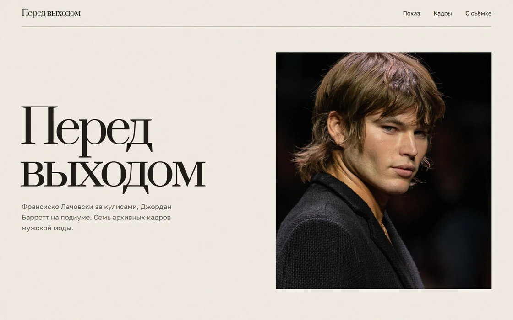

# Портфолио

[Открыть портфолио](https://egork9914-cyber.github.io/portfolio/)

## Перед выходом

Фотопоказ из семи архивных кадров мужской моды. Обложка построена вокруг портрета Джордана Барретта. В показе можно выбрать кадр по контактной ленте или запустить автопоказ.

[Открыть фотопоказ](https://egork9914-cyber.github.io/portfolio/pered-vyhodom/) · [Исходники проекта](docs/pered-vyhodom/) · [Фотокредиты](docs/pered-vyhodom/assets/photos/CREDITS.txt)

Сайт на HTML, CSS и JavaScript. Главная портфолио находится в `docs/index.html`. GitHub Pages публикует папку `docs` из ветки `main`.

Фото на обложке — Stefan Heesch, Nordfriisk Photography. [Оригинал](https://commons.wikimedia.org/wiki/File:Jordan-barrett-mbfw-march-2022-fashion-week-berlin.jpg) · [CC BY-SA 4.0](https://creativecommons.org/licenses/by-sa/4.0/).
